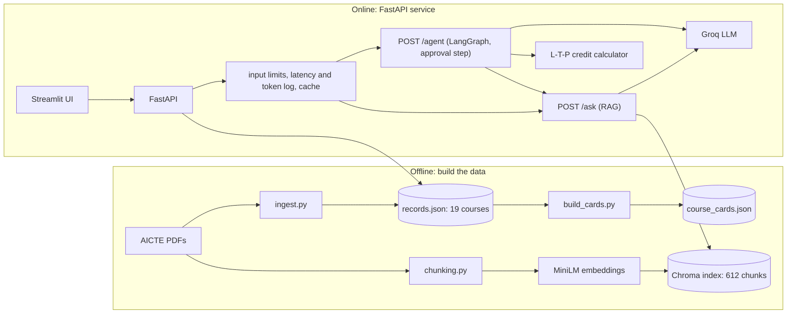

# CurriculumBuddy


**Ask the AICTE curriculum a question and get a cited answer in seconds, or an honest "I don't know."**

Live API: https://curriculumbuddy.onrender.com (`/health`, `/docs`, `/metrics`) · Demo video: 

## The problem
A new assistant professor at Sanjivani has to prepare a course plan for "Design and Analysis of Algorithms" aligned with the AICTE model curriculum. The facts are buried in 100+ page PDFs: course tables, module lists, book lists. Finding the L-T-P, credits, modules and prerequisites of one course means scrolling, and a wrong number in a course plan is expensive.

## What CurriculumBuddy does
- **Cited answers.** Every answer names its source file, page and course title. If the documents do not contain the answer, it says "I don't know based on the documents." instead of guessing.
- **A credit calculator the model cannot get wrong.** The agent calls a tool that applies the AICTE rule (credits = L + T + P/2) and compares it with the curriculum table. For Semester 2 the table lists 23 credits while the L-T-P calculation gives 25, and the audit course AU-102 is flagged.
- **Human approval for tools.** The LangGraph agent pauses and asks before it runs a tool.
- **Course card.** Pick a course and see its modules as a bar strip plus the chain of earlier courses it builds on. Bars are drawn only where the AICTE document gives durations, and inferred prerequisite links are labelled as inferred.


## Architecture


## Results
<!-- EVAL:START -->
## Evaluation (15 questions, 2 configs)

| Config | Chunk size | Top-k | Retrieval hit | Answer accuracy | Correct "I don't know" | Cited | Avg seconds |
|---|---|---|---|---|---|---|---|
| A | 1000 | 3 | 64% | 47% | 100% | 45% | 2.6 |
| B (winner) | 500 | 6 | 82% | 47% | 100% | 55% | 9.1 |

Winner: config B (chunk size 500, top-k 6). It retrieves the right chunk more often and cites more, with the same answer accuracy as A, but is slower because it sends more text to the model. Details: `eval/results.md`.
<!-- EVAL:END -->

15 questions, 2 retrieval configs (chunk size and top-k). One question asks for something the documents cannot answer (Savitribai Phule Pune University syllabus), to check that the assistant refuses. Details: `eval/results.md`. Prompt versions compared in `eval/prompt_compare.md`.

## Production notes
- **Logging.** Every request is timed and written to `data/requests.jsonl` (path, status, milliseconds, LLM calls, tokens). `GET /metrics` summarises latency per endpoint.
- **Tokens are estimates** (about 4 characters per token), not the provider's exact counts.
- **Cache.** Identical LLM prompts are answered from memory for 10 minutes (max 200 entries). It is per process, so it resets on restart or redeploy.
- **Input limits.** Request body over 10 KB returns 413. A `question` over 500 characters or empty, or `?q=` over 200 characters, returns 422. These are checked before any LLM call.
- **Prompt injection.** User text is only ever placed in the user message, never in the system prompt, and the agent runs only tools from a fixed list. Unknown tools and invalid arguments are rejected (tests in `tests/test_production.py` and `tests/test_agent_safety.py`).

Measured on 22 Nov 2026 with `python -m eval.measure` (6 questions, each asked twice):

| Measurement | Local (laptop) | Live (Render free tier, measured from India) |
|---|---|---|
| /health median latency (client side) | 31 ms | 1061 ms |
| /ask first call, median of 6 | 2793 ms | 8835 ms |
| /ask first call, slowest | 3117 ms | 9948 ms |
| /ask repeat (LLM answer cached), median | 776 ms | 7844 ms |
| Avg tokens in / out per LLM call (estimated) | 946 / 9.7 | 946 / 8.3 |
| Cache hit rate (each question asked twice) | 0.5 | 0.5 |
| Requests that failed | 0 of 12 | 0 of 12 |

The repeat call shows the effect of the LLM cache. On the live service it is still slow because retrieval (embedding the question and searching Chroma) runs on Render's free tier with 0.1 CPU and 512 MB RAM; locally it takes under a second. The live `/health` figure includes network distance to the Virginia region and a new connection per request; the server itself answers `/health` in about 1 ms. The free tier also sleeps after 15 minutes idle, so the first request can take about a minute.

## How to run
```
python -m venv venv
venv\Scripts\activate
pip install -r requirements.txt
python -m app.fetch        # download PDFs into data/raw/
python -m app.ingest       # build data/records.json
python -m app.build_cards  # build data/course_cards.json
python -m app.vectorstore  # build the Chroma index
uvicorn app.main:app --reload        # terminal 1
streamlit run ui/app.py              # terminal 2
```
Create `.env` from `.env.example` (`GROQ_API_KEY`, `GROQ_MODEL`).

### Run with Docker
```
docker compose build
docker compose run --rm api python -c "from app import vectorstore; print(vectorstore.index_all())"
docker compose up
```
API: http://localhost:8000/docs · UI: http://localhost:8501

## Quality
80+ pytest tests (records, API, credit calculator, agent, approval step, UI, input limits, injection), ruff, and GitHub Actions CI that runs ruff, pytest and a Docker build on every push and pull request.

```
python -m pytest -q
ruff check .
```

## API
| Endpoint | Purpose |
|---|---|
| `GET /health` | service check |
| `GET /records`, `GET /records/{course_code}` | course records |
| `GET /search?q=` | TF-IDF keyword search |
| `GET /search/semantic?q=` | Chroma semantic search with source, page, title |
| `POST /chat` | LLM chat with prompt version |
| `POST /ask` | RAG answer with citations or "I don't know" |
| `POST /agent` | agent with tools and an approval step |
| `POST /feedback` | thumbs up/down to `data/feedback.jsonl` |
| `GET /metrics` | latency, token estimates and cache stats |

## Data and honest limits
Sources: AICTE UG CSE and Mechanical Engineering model curricula (PDF) plus one CSE syllabus. Structured records cover the 19 courses of Semesters I-III. Module durations exist in the document only for Mathematics-I/II, CS-301, UHV-II and one chemistry module, so other courses show equal bars marked "duration not stated". Most prerequisite links are inferred from the subject sequence and labelled that way. The similarity score alone cannot tell answerable from unanswerable questions, so refusals rely on the prompt rule and are measured in the eval.

## Project structure
```
app/        API and logic (ingest, chunking, vectorstore, rag, tools, agent_loop, graph, metrics ...)
ui/         Streamlit app and course card helpers
eval/       eval set, run_eval.py, measure.py, search results, prompt comparison
prompts/    system, RAG and agent prompts
docs/       how_llms_work.md, resume.md, screenshots
tests/      pytest suite
```
Tags: `week-1`, `checkpoint-1`, `checkpoint-2`.