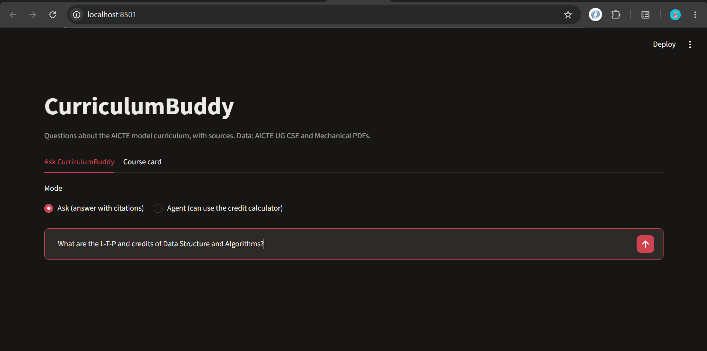
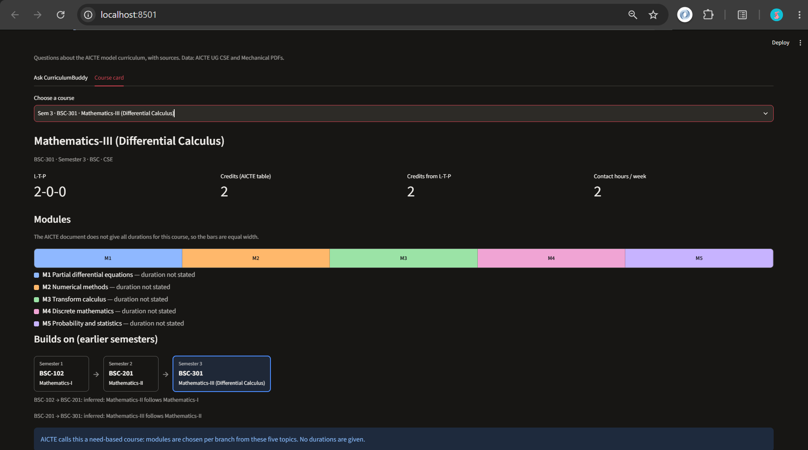

# CurriculumBuddy


Question answering over the AICTE model curricula for UG engineering, built day by day as a GenAI course project.

## Product
Q&A over AICTE model curricula for UG engineering: course contents module by module, L-T-P and credits, prerequisites, outcomes and suggested textbooks. Answers carry citations (source file, page, course title), and the assistant says "I don't know based on the documents." when the documents do not contain the answer.

## User
A newly joined assistant professor in the Computer Engineering department at Sanjivani who must prepare a course plan for "Design and Analysis of Algorithms" aligned with the AICTE model curriculum.

## Problem
Course details are buried in very long AICTE PDFs with course tables, module lists and book lists, making it slow to find modules, credits and prerequisites for a course plan.

## Data Source
- AICTE UG CSE model curriculum (PDF): https://www.aicte.gov.in/sites/default/files/Updated-AICTE%20-%20UG%20CSE.pdf
- AICTE Mechanical Engineering model curriculum (PDF): https://aicte.gov.in/sites/default/files/Final_Mechanical%20Engg.pdf
- A third CSE syllabus PDF (`Syllabus_CSE.pdf`) is also indexed for retrieval.

Structured records cover the 19 courses of Semesters I-III of the AICTE UG CSE table. The PDFs are not committed; `python -m app.fetch` downloads them.

## What it does
| Layer | What was built |
|---|---|
| Data | PDF download, ingestion into 19 course records, 612 retrieval chunks |
| API | FastAPI service with records, keyword search, semantic search, chat, RAG and agent endpoints |
| Retrieval | TF-IDF keyword search, then semantic search with ChromaDB and MiniLM embeddings |
| LLM | Groq / Gemini wrapper, two prompt versions, prompt comparison |
| RAG | `/ask` answers from retrieved chunks with `[n]` citations and refusals |
| Agent | Tool-using agent (RAG search + L-T-P credit calculator), hand-written loop and LangGraph version with memory and a human approval step |
| UI | Streamlit chat, thumbs feedback, and the course card with prerequisite chain |
| Quality | 60 pytest tests, ruff, Docker Compose |

## How to run
```
python -m venv venv
venv\Scripts\activate
pip install -r requirements.txt
python -m app.fetch        # download PDFs into data/raw/
python -m app.ingest       # build data/records.json
python -m app.build_cards  # build data/course_cards.json
python -m app.vectorstore  # build the Chroma index (data/chroma)
uvicorn app.main:app --reload
```
Create a `.env` file (see `.env.example`) with `GROQ_API_KEY` and `GROQ_MODEL` (for example `openai/gpt-oss-20b`).

Open http://127.0.0.1:8000/docs to try the API.

## API endpoints
| Endpoint | Purpose |
|---|---|
| `GET /health` | service check |
| `GET /records?limit=` | list course records |
| `GET /records/{course_code}` | one course record (404 if unknown) |
| `GET /search?q=` | TF-IDF keyword search |
| `POST /questions` | questions endpoint from week 1 |
| `POST /chat` | LLM chat with prompt version and top_k |
| `GET /search/semantic?q=` | Chroma semantic search with source, page and title |
| `POST /ask` | RAG answer with citations, or "I don't know" |
| `POST /agent` | agent with tools; pauses for approval before running a tool |
| `POST /feedback` | thumbs up/down, appended to `data/feedback.jsonl` |

## AICTE credit rule
Credits = L + T + P/2, and contact hours = L + T + P. Audit courses (AU-101, AU-102) have contact hours but 0 credits. The credit calculator tool flags this mismatch: for Semester 2 the listed credits total 23 while the L-T-P calculation gives 25, with AU-102 flagged.

## UI (Streamlit)
```
uvicorn app.main:app --reload     # terminal 1
streamlit run ui/app.py           # terminal 2
```
Chat with citations and 👍/👎 feedback (saved to `data/feedback.jsonl`), plus a course card with module bars and a prerequisite chain.




Module bars are drawn only where the AICTE document gives durations; other courses show equal bars marked "duration not stated".
Prerequisite links marked "inferred" are my own reading of the subject sequence, not AICTE text.

## Run with Docker

Needs Docker Desktop and a `.env` file with your `GROQ_API_KEY` and `GROQ_MODEL`.

```bash
docker compose build
docker compose run --rm api python -c "from app import vectorstore; print(vectorstore.index_all())"
docker compose up
```

- The first command builds the image (one image, used by both services).
- The second builds the Chroma index inside the container. Do it once; it is saved in `./data/chroma`.
- API: http://localhost:8000/docs
- UI: http://localhost:8501
- Stop with `Ctrl+C`, then `docker compose down`.

Tested: `docker compose up` starts the API and the Streamlit UI, and the UI calls `/agent` and `/feedback` successfully. The first build takes about 15 minutes on a slow connection; the embedding model (about 80 MB) downloads once into a Docker volume.

<!-- EVAL:START -->
## Evaluation (15 questions, 2 configs)

| Config | Chunk size | Top-k | Retrieval hit | Answer accuracy | Correct "I don't know" | Cited | Avg seconds |
|---|---|---|---|---|---|---|---|
| A | 1000 | 3 | 64% | 40% | 100% | 36% | 3.4 |
| B (winner) | 500 | 6 | 82% | 53% | 100% | 73% | 7.2 |

Winner: config B (chunk size 500, top-k 6). Details: `eval/results.md`.
<!-- EVAL:END -->

Note: retrieval hit (82% for config B) is a real measurement. The 0% answer accuracy in this run is not reliable if the LLM calls failed; an earlier run hit Groq's HTTP 429 rate limit. Re-run `python -m eval.run_eval` to refresh the table.

## Tests and lint

```bash
python -m pytest -q    # 60 passed
ruff check .
```

The tests cover:
- records and API: record count, unique course codes, `/health`, `/records`, `/search`, 404 for unknown courses, `/ask` with a fake LLM, feedback validation
- the L-T-P credit calculator: AICTE mapping, semester totals, audit-course mismatches and input validation
- the agent: tool calling, unknown tools, the 5-step limit, LLM failure, recovery from a rejected tool-call reply, and the LangGraph approval step, rejection and per-thread memory
- the UI: course card data, module bars and a headless Streamlit run

All tests use fakes, so they need no API key and no internet.

## Project structure
```
app/            API and logic: fetch, ingest, records, cli, main, smart_search, llm, chat,
                chunking, embed, vectorstore, rag, tools, agent_loop, graph, build_cards
ui/             Streamlit app (app.py) and course card helpers (cards.py)
eval/           eval_set.json, run_eval.py, search_results.md, prompt comparison
prompts/        system, RAG and agent prompts
analysis/       explore.py (pandas facts about the records)
docs/           how_llms_work.md and UI screenshots
tests/          pytest suite
data/           records.json, course_cards.json (raw PDFs, Chroma index and feedback are not committed)
day01_intro.py, day01_menu.py   Day 1 exercises
```
`RAG_LLM_Model/` is a separate practice folder and is not part of CurriculumBuddy.

Data exploration: `python -m analysis.explore`

## Known limits
- Structured records cover Semesters I-III only (19 courses); the PDFs contain more text that is searchable but not in the records.
- Module durations exist in the document only for Mathematics-I/II (hours), CS-301 (weeks), UHV-II (lectures) and one chemistry module; four Semester III courses have no module list; Physics-I has four options and the card shows option 1.
- Prerequisite links are mostly inferred from the subject sequence and are labelled as such.
- The semantic similarity score cannot separate answerable from unanswerable questions, so refusals rely on the prompt rule and are measured in the eval.

## Milestones (git tags)
`week-1` (API, search, pandas), `checkpoint-1` (docs and diagram), `checkpoint-2` (UI and live demo).