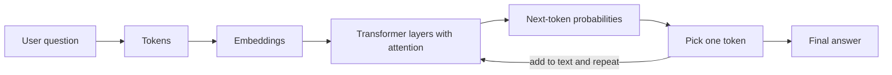

# How LLMs Work

An LLM (large language model) is a program that has read a huge amount of text
and learned to predict the next word. When I ask it a question, it does not look
the answer up. It writes the answer one small piece at a time.

## The steps
1. **Tokens:** my text is cut into small pieces called tokens (a word or part of a word).
2. **Numbers:** each token becomes a list of numbers called an embedding, so the
   model can work with meaning as maths.
3. **Transformer:** layers of attention let the model see which earlier words matter
   most for the next one (for example, which course "it" refers to).
4. **Prediction:** the model gives a probability for every possible next token and
   picks one.
5. **Repeat:** the chosen token is added to the text and the model predicts again,
   until the answer is finished.

## Diagram

## Why this matters for CurriculumBuddy
- An LLM can sound sure and still be wrong (hallucination), for example by inventing
  a course code or a credit value.
- It only knows its training data, not the AICTE curriculum PDFs.
- So CurriculumBuddy first finds the right course records in the data (retrieval),
  then gives only those records to the model. The answer then comes from AICTE
  data, not from the model's memory.
- If the data has no answer (like the SPPU syllabus), the correct reply is "not in my data".